


  

I started with robots and kept moving up the stack. Every project here is one stop on the same loop: a robot **moves**, a vision model **sees**, a retrieval system **knows** (and cites its sources), an agent **acts** (with a human in the loop), and a product **ships**. What each stage learns feeds the next.


  


<a href="https://github.com/aryankhanna1409/autonomous-bot"></a>
<a href="https://github.com/aryankhanna1409/autonomous-bot"></a>

<a href="https://github.com/aryankhanna1409/sentinel"></a>

<a href="https://github.com/aryankhanna1409/finintel"></a>

<a href="https://github.com/aryankhanna1409/nexus">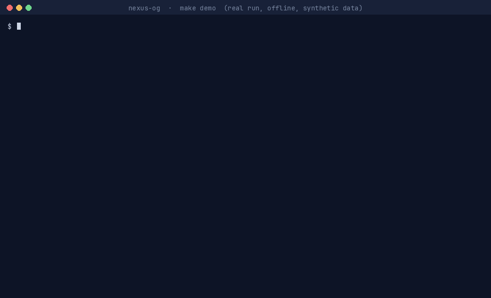</a>
<a href="https://github.com/aryankhanna1409/nexus"></a>

<a href="https://github.com/aryankhanna1409/dishdecoded"></a>

 


  


  


  


