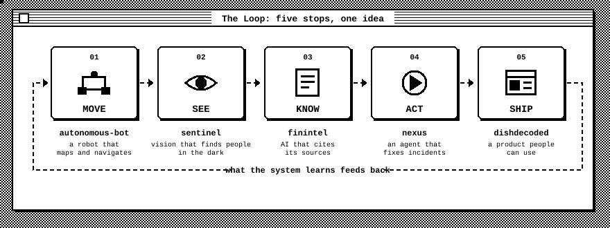

<code>Pune, IN</code> ·
<code>B.Tech Robotics, class of 2027</code> ·
<code>published, IJCIS 2025</code>

 

I started with robots and kept moving up the stack. Every project here is one stop on the same loop: a robot **moves**, a vision model **sees**, a retrieval system **knows** (and cites its sources), an agent **acts** (with a human in the loop), and a product **ships**. What each stage learns feeds the next.

 

<table>
  <tr><td align="center" width="50%" valign="top"><a href="https://github.com/aryankhanna1409/autonomous-bot"><b>01 MOVE · autonomous-bot</b></a> A ROS 2 robot that maps, localises and navigates on its own, with an IoT dashboard and a swarm auction  <i>No demo recording yet</i></td><td align="center" width="50%" valign="top"><a href="https://github.com/aryankhanna1409/sentinel"><b>02 SEE · sentinel</b></a> Search-and-rescue vision: YOLO11 on RGB and simulated thermal feeds to find people in the dark </td></tr>
  <tr><td align="center" width="50%" valign="top"><a href="https://github.com/aryankhanna1409/finintel"><b>03 KNOW · finintel</b></a> A financial RAG system that writes grounded, citation-backed reports from filings </td><td align="center" width="50%" valign="top"><a href="https://github.com/aryankhanna1409/nexus"><b>04 ACT · nexus</b></a> Network intelligence and an autonomous DevSecOps agent (Claude or NVIDIA NIM) that finds the root cause and fixes the incident </td></tr>
  <tr><td align="center" width="50%" valign="top" colspan=2><a href="https://github.com/aryankhanna1409/dishdecoded"><b>05 SHIP · dishdecoded</b></a> Snap a dish or a menu and get its story, allergens and a recipe </td></tr>
</table>

 

<b>Research:</b> 62.5% better reward personalisation from a Random Forest, XGBoost and K-Means system, published in the <i>International Journal of Computational Intelligence Systems</i> (2025).

 

