

 

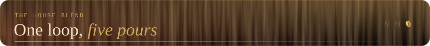

I started with robots and kept moving up the stack. Every project here is one pour of the same brew: a robot **moves**, a vision model **sees**, a retrieval system **knows** (and cites its sources), an agent **acts** (with a human in the loop), and a product **ships**. What each stage learns feeds the next.


 

IMU fused through an error-state Kalman filter, 2D SLAM with slam_toolbox, Nav2 path planning, a live browser dashboard over MQTT, and a swarm auction on OpenRMF where every robot bids its total ETA. Built as a team for warehouse and hospital logistics.

 

<a href="https://github.com/aryankhanna1409/sentinel"></a>

A YOLO11 detector trained for crowded, occluded scenes, with tracking, a radar view and a casualty cue for people lying still. The thermal view runs on a simulated feed today. A real thermal camera plugs into the same loop and works straight away.

 

<a href="https://github.com/aryankhanna1409/finintel"></a>

Ingests SEC filings, 13F holdings, insider trades and earnings calls, retrieves with BM25 plus dense search, and refuses to answer without citing evidence. A prototype that covers a small set of companies so far: the worked example benchmarks Target against Walmart, Costco, Dollar General and Kroger.

 

<a href="https://github.com/aryankhanna1409/nexus"></a>

A prototype for a simulated telecom network. A C library parses call records, monitoring watches 17 health metrics per tower, and a root-cause engine lines alarms up against recent deployments. The AI can investigate and explain, but fixes wait for a human to approve them.

 

<a href="https://github.com/aryankhanna1409/dishdecoded"></a>

Seven features on one engine: dish identifier, allergen check, pairings, food culture, recipe, menu decoder and a pantry mode. One vision call per request, validated against a schema, with a free demo mode.

 

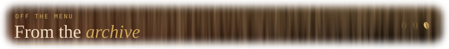

Earlier builds and side projects. Smaller cups, same beans.

<a href="https://github.com/aryankhanna1409/one-click-crave">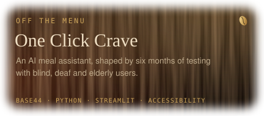</a>
<a href="https://github.com/aryankhanna1409/SnackSave">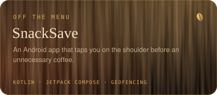</a>
<a href="https://github.com/aryankhanna1409/credit-card">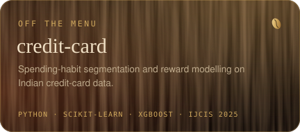</a>
<a href="https://github.com/aryankhanna1409/kinematics-calculator">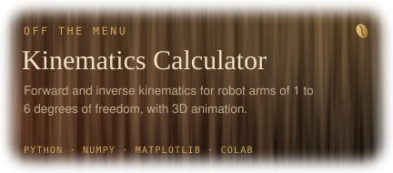</a>
<a href="https://github.com/aryankhanna1409/fakespotter">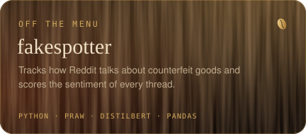</a>
<a href="https://github.com/aryankhanna1409/murdle">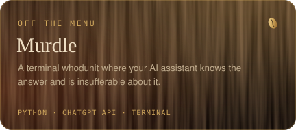</a>
<a href="https://github.com/aryankhanna1409/overthinkers-assistant">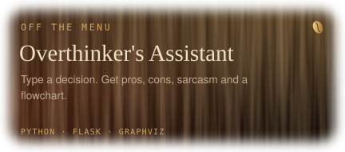</a>
<a href="https://github.com/aryankhanna1409/auto_wordle">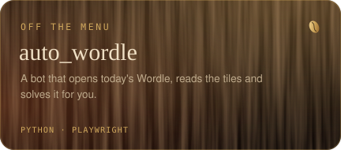</a>

<b>One Click Crave is live:</b> <a href="https://one-click-crave.base44.app/">one-click-crave.base44.app</a>. Also built, not on GitHub: a 360° radar rig that scans its surroundings and feeds obstacle positions to a robot's navigation.

 

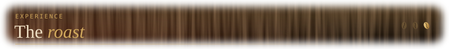


 

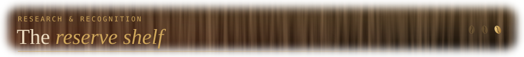

 

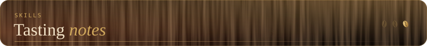


 

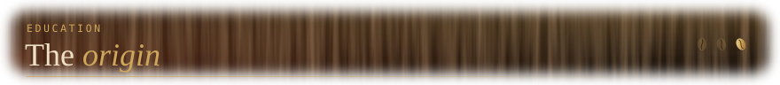

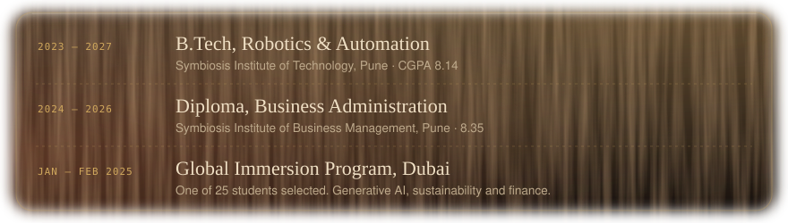

 

<a href="https://orcid.org/0009-0001-1710-2367">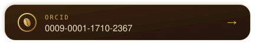</a>

