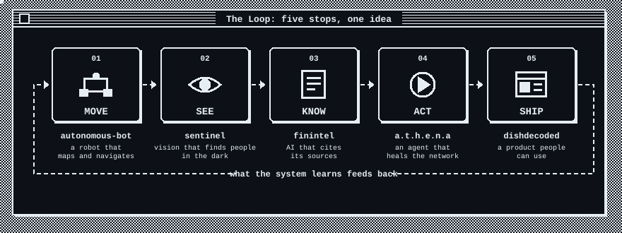
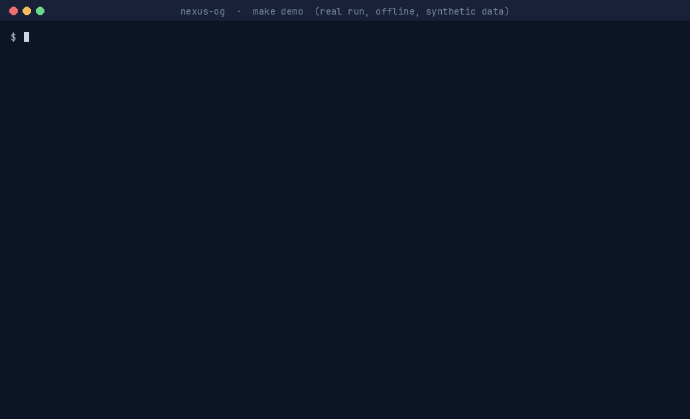

<picture><source media="(prefers-color-scheme: light)" srcset="assets/hero-light.svg" /></picture>

<code>Pune, IN</code> ·
<code>B.Tech Robotics, class of 2027</code> ·
<code>incoming FDE intern @ Incedo</code> ·
<code>published, IJCIS 2025</code>

 

<picture><source media="(prefers-color-scheme: light)" srcset="assets/section-01-light.svg" /></picture>

I started with robots and kept moving up the stack. Every project here is one stop on the same loop: a robot **moves**, a vision model **sees**, a retrieval system **knows** (and cites its sources), an agent **acts** (with a human in the loop), and a product **ships**. What each stage learns feeds the next.

<picture><source media="(prefers-color-scheme: light)" srcset="assets/story-light.svg" /></picture>

 

<picture><source media="(prefers-color-scheme: light)" srcset="assets/section-02-light.svg" /></picture>

<table>
  <tr><td align="center" width="50%" valign="top"><a href="https://github.com/aryankhanna1409/autonomous-bot"><b>01 MOVE · autonomous-bot</b></a> A ROS 2 robot that maps, localises and navigates on its own, with an IoT dashboard and a swarm auction on OpenRMF  <i>No demo recording yet</i></td><td align="center" width="50%" valign="top"><a href="https://github.com/aryankhanna1409/sentinel"><b>02 SEE · sentinel</b></a> Search-and-rescue vision: YOLO11 on RGB and thermal feeds to find people in the dark. Thermal runs on a simulated feed today; a real camera plugs straight in </td></tr>
  <tr><td align="center" width="50%" valign="top"><a href="https://github.com/aryankhanna1409/finintel"><b>03 KNOW · finintel</b></a> A financial RAG prototype that writes grounded, citation-backed reports from filings (real data, a small set of companies so far) </td><td align="center" width="50%" valign="top"><a href="https://github.com/aryankhanna1409/a.t.h.e.n.a"><b>04 ACT · A.T.H.E.N.A.</b></a> Agentic Telemetry, Healing &amp; Network Assurance: reads call logs in C, watches 17 network KPIs with statistical, Isolation Forest and GRU detectors, explains incidents with a tool-using LLM, and fixes them behind a human approval gate  <b>90/90</b> faults caught and root-caused · <b>0</b> false incidents in 600 cell-hours · 88% RCA on subtle faults (all data synthetic)  Its first version, <a href="https://github.com/aryankhanna1409/nexus">nexus</a>: </td></tr>
  <tr><td align="center" width="50%" valign="top" colspan=2><a href="https://github.com/aryankhanna1409/dishdecoded"><b>05 SHIP · dishdecoded</b></a> Snap a dish or a menu and get its story, allergens and a recipe </td></tr>
</table>

<b>From the archive:</b> <a href="https://github.com/aryankhanna1409/one-click-crave">One Click Crave</a> (AI meal assistant, live at <a href="https://one-click-crave.base44.app/">one-click-crave.base44.app</a>) · <a href="https://github.com/aryankhanna1409/SnackSave">SnackSave</a> · <a href="https://github.com/aryankhanna1409/credit-card">credit-card</a> · <a href="https://github.com/aryankhanna1409/kinematics-calculator">kinematics-calculator</a> · <a href="https://github.com/aryankhanna1409/fakespotter">fakespotter</a> · <a href="https://github.com/aryankhanna1409/murdle">murdle</a> · <a href="https://github.com/aryankhanna1409/overthinkers-assistant">overthinkers-assistant</a> · <a href="https://github.com/aryankhanna1409/auto_wordle">auto_wordle</a>

 

<picture><source media="(prefers-color-scheme: light)" srcset="assets/section-03-light.svg" /></picture>

- **Forward Deployed Engineer intern, Incedo** (Hi-Tech, Pune), January to July 2027, part of the North Stars program
- **Aegis-Net:** my project for the internship, in progress (not public yet)
- **A.T.H.E.N.A.:** moving from synthetic to real telecom data
- **AWS Certified AI Practitioner**, October 2026, plus twelve Claude Academy courses
- **Research Assistant**, Symbiosis Institute of Technology, since September 2024
- **DD Robocon 2026** with Team Robominds: 90/100 in the preliminary round, through to the National Finals at IIT Delhi
- **Patent application published:** IoT-enabled low-cost mobile robot system for autonomous search and rescue

 

<picture><source media="(prefers-color-scheme: light)" srcset="assets/section-04-light.svg" /></picture>

<picture><source media="(prefers-color-scheme: light)" srcset="assets/extensions-light.svg" /></picture>

<b>Research:</b> 62.5% better reward personalisation from a Random Forest, XGBoost and K-Means system, published in the <i>International Journal of Computational Intelligence Systems</i> (2025).

 

<picture><source media="(prefers-color-scheme: light)" srcset="assets/section-05-light.svg" /></picture>

<a href="mailto:aryankhanna2k22@gmail.com"><picture><source media="(prefers-color-scheme: light)" srcset="assets/btn-email-light.svg" /></picture></a>
<a href="https://www.linkedin.com/in/aryandkhanna"><picture><source media="(prefers-color-scheme: light)" srcset="assets/btn-linkedin-light.svg" /></picture></a>
<a href="https://github.com/aryankhanna1409"><picture><source media="(prefers-color-scheme: light)" srcset="assets/btn-github-light.svg" /></picture></a>
<a href="https://orcid.org/0009-0001-1710-2367"><picture><source media="(prefers-color-scheme: light)" srcset="assets/btn-orcid-light.svg" /></picture></a>

<picture><source media="(prefers-color-scheme: light)" srcset="assets/footer-light.svg" /></picture>

