<picture><source media="(prefers-color-scheme: light)" srcset="assets/light/hero.svg" /></picture>

<a href="https://github.com/aryankhanna1409">
  <picture><source media="(prefers-color-scheme: light)" srcset="https://readme-typing-svg.demolab.com?font=JetBrains+Mono&weight=500&size=18&pause=1400&color=0E7490&center=true&vCenter=true&width=760&lines=I+build+intelligent+systems+that+start+on+a+robot;...and+end+in+software.;Sensing+%C2%B7+Planning+%C2%B7+Learning+%C2%B7+Data+systems" /></picture>
</a>

  <a href="#identity"><code>01 IDENTITY</code></a> ·
  <a href="#engineering"><code>02 ENGINEERING</code></a> ·
  <a href="#projects"><code>03 PROJECTS</code></a> ·
  <a href="#systems"><code>04 SYSTEMS</code></a> ·
  <a href="#experience"><code>05 EXPERIENCE</code></a> ·
  <a href="#contact"><code>06 CONTACT</code></a>

  <picture><source media="(prefers-color-scheme: light)" srcset="https://img.shields.io/badge/Pune,_IN-eaeef2?style=flat-square&logo=googlemaps&logoColor=0e7490" /></picture>
  <picture><source media="(prefers-color-scheme: light)" srcset="https://img.shields.io/badge/B.Tech-class_of_2027-eaeef2?style=flat-square" /></picture>
  <picture><source media="(prefers-color-scheme: light)" srcset="https://img.shields.io/badge/research_assistant-since_Sep_2024-eaeef2?style=flat-square" /></picture>
  <picture><source media="(prefers-color-scheme: light)" srcset="https://img.shields.io/badge/published-IJCIS_2025-eaeef2?style=flat-square" /></picture>

<picture><source media="(prefers-color-scheme: light)" srcset="assets/light/terminal.svg" /></picture>

---

### `SCENE 01 — IDENTITY`

Final-year robotics engineer, **moving up the stack** from machines to the AI and software that run them.

I'm finishing a **B.Tech in Robotics & Automation** at Symbiosis Institute of Technology, Pune (2023–2027), with a diploma in business administration from SIBM Pune on the side. Since September 2024 I've been a research assistant working across machine learning, autonomous robotics and computer vision, including an IoT-enabled autonomous mobile robot, a multimodal RGB-thermal search-and-rescue system and a published ML model for credit-card reward personalisation. The through-line is systems: a robot is a sensing-and-decision pipeline, and a model is only useful inside a system that feeds and checks it. That's where I'm heading: AI and software systems that hold up outside a notebook.

- 🔭 **Currently working on:** a multimodal RGB-thermal search-and-rescue scanner ([Sentinel](https://github.com/aryankhanna1409/sentinel)) and an IoT-enabled autonomous mobile robot ([autonomous-bot](https://github.com/aryankhanna1409/autonomous-bot))
- 💡 **Interested in:** computer vision, embedded systems, applied AI
- 💬 **Ask me about:** YOLO pipelines, ROS 2 and Nav2, sensor fusion, RAG systems, robot swarms
- 🧑 **Pronouns:** he/him
- ☕ **Fun fact:** coffee nerd

#### `THE PATH · ROBOTICS → AI → SYSTEMS`

<picture><source media="(prefers-color-scheme: light)" srcset="assets/light/pipeline.svg" /></picture>

| Stage | Focus | Proof |
|---|---|---|
| **01 · Robotics** | Sensing, kinematics, control and embedded hardware: where real systems fail at the interfaces | IoT autonomous mobile robot · IR path-following AGV design |
| **02 · AI** | Perception and learning for physical and financial problems | Sentinel RGB-thermal rescue scanner · reward-optimisation ML (published, IJCIS 2025) |
| **03 · Systems** | Architecture: telemetry, data models, correlation, retrieval, reporting | finintel RAG system · Aegis-Net network intelligence · CollegeOS data architecture |

---

### `SCENE 02 — ENGINEERING`

Grouped by what I use them for. Only tools I've actually built with, no percentage bars.

<picture><source media="(prefers-color-scheme: light)" srcset="assets/light/orbit.svg" /></picture>

  <picture><source media="(prefers-color-scheme: light)" srcset="https://img.shields.io/badge/Python-eaeef2?style=for-the-badge&logo=python&logoColor=1f6feb" /></picture>
  <picture><source media="(prefers-color-scheme: light)" srcset="https://img.shields.io/badge/C++-eaeef2?style=for-the-badge&logo=cplusplus&logoColor=1f6feb" /></picture>
  <picture><source media="(prefers-color-scheme: light)" srcset="https://img.shields.io/badge/ROS%202-eaeef2?style=for-the-badge&logo=ros&logoColor=1f6feb" /></picture>
  <picture><source media="(prefers-color-scheme: light)" srcset="https://img.shields.io/badge/PyTorch-eaeef2?style=for-the-badge&logo=pytorch&logoColor=1f6feb" /></picture>
  <picture><source media="(prefers-color-scheme: light)" srcset="https://img.shields.io/badge/OpenCV-eaeef2?style=for-the-badge&logo=opencv&logoColor=1f6feb" /></picture>
  <picture><source media="(prefers-color-scheme: light)" srcset="https://img.shields.io/badge/YOLO11-eaeef2?style=for-the-badge&logo=yolo&logoColor=1f6feb" /></picture>
  <picture><source media="(prefers-color-scheme: light)" srcset="https://img.shields.io/badge/Arduino-eaeef2?style=for-the-badge&logo=arduino&logoColor=1f6feb" /></picture>
  <picture><source media="(prefers-color-scheme: light)" srcset="https://img.shields.io/badge/Jetson-eaeef2?style=for-the-badge&logo=nvidia&logoColor=1f6feb" /></picture>
  <picture><source media="(prefers-color-scheme: light)" srcset="https://img.shields.io/badge/SQL-eaeef2?style=for-the-badge&logo=postgresql&logoColor=1f6feb" /></picture>
  <picture><source media="(prefers-color-scheme: light)" srcset="https://img.shields.io/badge/Streamlit-eaeef2?style=for-the-badge&logo=streamlit&logoColor=1f6feb" /></picture>
  <picture><source media="(prefers-color-scheme: light)" srcset="https://img.shields.io/badge/React-eaeef2?style=for-the-badge&logo=react&logoColor=1f6feb" /></picture>
  <picture><source media="(prefers-color-scheme: light)" srcset="https://img.shields.io/badge/Git-eaeef2?style=for-the-badge&logo=git&logoColor=1f6feb" /></picture>

| Robotics & control | Perception | ML & data | Software & embedded |
|---|---|---|---|
| ROS / ROS 2 | Computer vision | Random Forest · XGBoost | Python · C++ |
| Sensor fusion | OpenCV · YOLO11 | K-Means clustering | SQL · SQLAlchemy · Pydantic |
| Motion planning (PSO, SFLA) | RGB-thermal fusion | RAG chatbots | Streamlit · React |
| PID differential drive | LiDAR indexing (KD-tree) | Data analytics | Arduino · STM32 · Jetson |
| Kinematics (DH) · IoT | | LLM apps · Power BI | |

---

### `SCENE 03 — PROJECTS`

<table>
  <tr><td width="50%"><a href="https://github.com/aryankhanna1409/sentinel"><picture><source media="(prefers-color-scheme: light)" srcset="assets/light/banners/sentinel.svg" /></picture></a></td><td width="50%"><a href="https://github.com/aryankhanna1409/autonomous-bot"><picture><source media="(prefers-color-scheme: light)" srcset="assets/light/banners/autonomous-bot.svg" /></picture></a></td></tr>
  <tr><td width="50%"><a href="https://github.com/aryankhanna1409/finintel"><picture><source media="(prefers-color-scheme: light)" srcset="assets/light/banners/finintel.svg" /></picture></a></td><td width="50%"><a href="https://github.com/aryankhanna1409/style-transfer-cnn"><picture><source media="(prefers-color-scheme: light)" srcset="assets/light/banners/style-transfer-cnn.svg" /></picture></a></td></tr>
  <tr><td width="50%"><a href="https://github.com/aryankhanna1409/overthinkers-assistant"><picture><source media="(prefers-color-scheme: light)" srcset="assets/light/banners/overthinkers-assistant.svg" /></picture></a></td><td width="50%"><a href="https://github.com/aryankhanna1409/one-click-crave"><picture><source media="(prefers-color-scheme: light)" srcset="assets/light/banners/one-click-crave.svg" /></picture></a></td></tr>
  <tr><td width="50%"><a href="https://github.com/aryankhanna1409/auto_wordle"><picture><source media="(prefers-color-scheme: light)" srcset="assets/light/banners/auto_wordle.svg" /></picture></a></td><td width="50%"><a href="https://github.com/aryankhanna1409/murdle"><picture><source media="(prefers-color-scheme: light)" srcset="assets/light/banners/murdle.svg" /></picture></a></td></tr>
  <tr><td width="50%"><a href="https://github.com/aryankhanna1409/SnackSave"><picture><source media="(prefers-color-scheme: light)" srcset="assets/light/banners/snacksave.svg" /></picture></a></td><td width="50%"><a href="https://github.com/aryankhanna1409/credit-card"><picture><source media="(prefers-color-scheme: light)" srcset="assets/light/banners/credit-card.svg" /></picture></a></td></tr>
  <tr><td width="50%"><a href="https://github.com/aryankhanna1409/nexus-ai"><picture><source media="(prefers-color-scheme: light)" srcset="assets/light/banners/nexus-ai.svg" /></picture></a></td><td width="50%"><a href="https://github.com/aryankhanna1409/kinematics-calculator"><picture><source media="(prefers-color-scheme: light)" srcset="assets/light/banners/kinematics-calculator.svg" /></picture></a></td></tr>
  <tr><td width="50%"><a href="https://github.com/aryankhanna1409/dishdecoded"><picture><source media="(prefers-color-scheme: light)" srcset="assets/light/banners/dishdecoded.svg" /></picture></a></td><td width="50%"><a href="https://github.com/aryankhanna1409/fakespotter"><picture><source media="(prefers-color-scheme: light)" srcset="assets/light/banners/fakespotter.svg" /></picture></a></td></tr>
</table>

 

#### `IN ACTION`

<table align="center">
  <tr>
    <td align="center" width="50%"> <b>Sentinel</b> · RGB → NIR → thermal targeting HUD</td>
    <td align="center" width="50%"> <b>finintel</b> · grounded, citation-backed reports</td>
  </tr>
  <tr>
    <td align="center" width="50%"> <b>Overthinker's Assistant</b> · decision trees from a sentence</td>
    <td align="center" width="50%"> <b>One Click Crave</b> · meal picker that learns your habits</td>
  </tr>
  <tr>
    <td align="center" colspan="2"> <b>Kinematics Calculator</b> · forward and inverse kinematics, animated in 3D</td>
  </tr>
</table>

 

#### `LIVE FROM GITHUB`

  <picture><source media="(prefers-color-scheme: light)" srcset="assets/light/contributions.svg" /></picture>

  <picture><source media="(prefers-color-scheme: light)" srcset="https://raw.githubusercontent.com/aryankhanna1409/aryankhanna1409/output/snake-light.svg" /></picture>

  <picture><source media="(prefers-color-scheme: light)" srcset="assets/light/languages.svg" /></picture>

---

### `SCENE 04 — SYSTEMS & CASE STUDIES`

The research behind some of the repos above, plus coursework and private builds that aren't public.

| Project | What it is | Stack |
|---|---|---|
| **Aegis-Net**  flagship · systems | Network intelligence and autonomous DevSecOps: telemetry → C analytics engine → anomaly detection → correlation / root cause → LLM explanation → recommended action → dashboard | C · Python · LLM · telemetry |
| **IoT Autonomous Mobile Robot**  robotics · research | Research robot that takes tasks over IoT and allocates them autonomously, framed for warehouse and hospital-logistics use. Public ROS 2 side: [autonomous-bot](https://github.com/aryankhanna1409/autonomous-bot) | Embedded · IoT · task allocation |
| **Sentinel**  computer vision · research | RGB + thermal fusion so people are easier to find in the dark. Code: [sentinel](https://github.com/aryankhanna1409/sentinel) | YOLO11 · OpenCV · thermal |
| **Credit-card reward optimisation**  applied ML · published | Segment spenders, then personalise rewards. Notebooks: [credit-card](https://github.com/aryankhanna1409/credit-card) | Random Forest · XGBoost · K-Means |
| **LiDAR spatial indexing**  algorithms · coursework | KD-tree index for nearest-neighbour and radius queries on streaming point clouds (my part of a group project) | Python · KD-tree |
| **IR path-following AGV**  design · simulation | Differential-drive hospital AGV that follows a marked path to carry medicine, with an optional 2-DOF arm | Arduino · PID · DH kinematics |
| **CollegeOS**  software · personal tool | Streamlit attendance manager that keeps an 80% target visible across overlapping lecture and lab slots | Streamlit · SQLAlchemy · Pydantic |
| **Shakespeare RAG chatbot**  LLM apps | Two versions: a Mistral wrapper, and one built from scratch | Python · RAG · Mistral |

---

### `SCENE 05 — EXPERIENCE`

Research first, leadership alongside.

<picture><source media="(prefers-color-scheme: light)" srcset="assets/light/experience.svg" /></picture>

<b>Roles in detail</b>

 

| When | Role | What I did |
|---|---|---|
| Sep 2024 – now | **Research Assistant** · Symbiosis Institute of Technology | Faculty-led work across ML, autonomous robotics and computer vision: the credit-card reward model (published), an IoT warehouse robot, and the RGB-thermal rescue scanner now in development |
| Jul – Dec 2025 | **Research Intern** · Symbiosis Centre for Applied AI | Built and evaluated models for real-world deployment, compliance and automation; designed validation experiments; literature reviews |
| Aug 2025 – now | **Student Coordinator** · Symbiosis Centre of Health Care | Campus Wellness Advisory Committee: initiatives reaching 500+ students, student–faculty liaison |
| Mar – Dec 2025 | **Club Head** · Robotics Process Automation Club | Re-established the club; 5+ workshops, webinars and industry events for 150+ students |
| Jul – Sep 2025 | **Student Coordinator** · SymbITech 2025 | Logistics, materials, budgeting and on-ground execution with student teams |

<b>Education & certifications</b>

 

- **B.Tech, Robotics & Automation Engineering**, Symbiosis Institute of Technology, Pune · Jun 2023 – Jun 2027
- **Diploma, Business Administration & Management**, Symbiosis Institute of Business Management, Pune · Jan 2024 – Jun 2026
- Certifications: Advanced Data Analytics Specialization · Python and SQL Basics · Operating Systems · Digital Marketing Tools and Techniques · Python Bootcamps

#### `RESEARCH`

**62.5% better reward personalisation** from an ML system combining Random Forest, XGBoost and K-Means, published in the *International Journal of Computational Intelligence Systems* (2025). Five publications in total, across applied ML, AI ethics and consumer behaviour.

<b>Publications</b>

 

1. Analyzing and Rewarding Credit Card Spending Habits in India: A Machine Learning Approach
2. Credit Card Hyperpersonalization and Retention Strategies Using AI
3. Ethical Implications of AI and Machine Learning in Business Decisions
4. Beyond the Counterfeit: Shaping Consumer Behavior and Luxury Brand Strategy Through Psychological and Cultural Insights
5. Unleashing the Power Within: Subconscious Thought as a Soft Skill in Contemporary Society

---

### `SCENE 06 — CONTACT`

**Building in robotics, AI or software systems? Say hello.**

<a href="mailto:forestfocus1@gmail.com"><picture><source media="(prefers-color-scheme: light)" srcset="assets/light/contact-email.svg" /></picture></a>
<a href="https://www.linkedin.com/in/aryandkhanna1"><picture><source media="(prefers-color-scheme: light)" srcset="assets/light/contact-linkedin.svg" /></picture></a>
<a href="https://github.com/aryankhanna1409"><picture><source media="(prefers-color-scheme: light)" srcset="assets/light/contact-github.svg" /></picture></a>

`ROBOTICS · AI · SOFTWARE` · Pune, Maharashtra, IN

<picture><source media="(prefers-color-scheme: light)" srcset="assets/light/footer.svg" /></picture>

