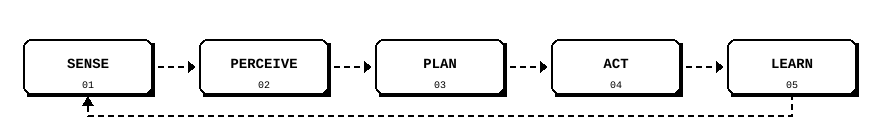
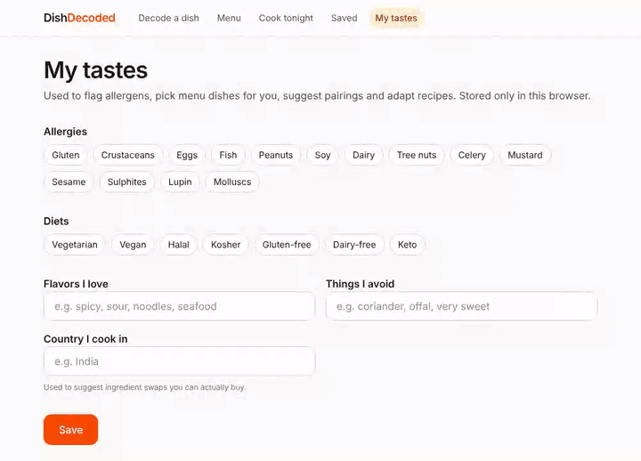

<code>Pune, IN</code> ·
<code>B.Tech, class of 2027</code> ·
<code>research assistant since Sep 2024</code> ·
<code>published, IJCIS 2025</code>

 

Final-year robotics engineer, **moving up the stack** from machines to the AI and software that run them.

I'm finishing a **B.Tech in Robotics & Automation** at Symbiosis Institute of Technology, Pune (2023–2027), with a diploma in business administration from SIBM Pune on the side. Since September 2024 I've been a research assistant across machine learning, autonomous robotics and computer vision: an IoT-enabled autonomous mobile robot, a multimodal RGB-thermal search-and-rescue system, and a published ML model for credit-card reward personalisation.

The through-line is systems. A robot is a sensing-and-decision pipeline, and a model is only useful inside a system that feeds and checks it.

- **Now:** [Sentinel](https://github.com/aryankhanna1409/sentinel) (RGB-thermal rescue scanner) and [autonomous-bot](https://github.com/aryankhanna1409/autonomous-bot) (IoT mobile robot on ROS 2)
- **Interested in:** computer vision, embedded systems, applied AI
- **Ask me about:** YOLO pipelines, ROS 2 and Nav2, sensor fusion, RAG systems, robot swarms
- **Fun fact:** coffee nerd

| Stage | Focus | Proof |
|---|---|---|
| **Robotics** | Sensing, kinematics, control, embedded hardware | IoT autonomous mobile robot · IR path-following AGV |
| **AI** | Perception and learning for physical and financial problems | Sentinel · reward-optimisation ML (IJCIS 2025) |
| **Systems** | Telemetry, data models, retrieval, reporting | finintel · Aegis-Net · CollegeOS |

 

Only tools I've actually built with.

| Robotics & control | Perception | ML & data | Software & embedded |
|---|---|---|---|
| ROS / ROS 2 | Computer vision | Random Forest · XGBoost | Python · C++ |
| Sensor fusion | OpenCV · YOLO11 | K-Means clustering | SQL · SQLAlchemy · Pydantic |
| Motion planning (PSO, SFLA) | RGB-thermal fusion | RAG chatbots | Streamlit · React |
| PID differential drive | LiDAR indexing (KD-tree) | LLM apps · Power BI | Arduino · STM32 · Jetson |
| Kinematics (DH) · IoT | | | Git |

 

| | Project | What it is |
|---|---|---|
| 💾 | [**Sentinel**](https://github.com/aryankhanna1409/sentinel) | RGB + thermal fusion with YOLO11 so people are easier to find in the dark |
| 💾 | [**autonomous-bot**](https://github.com/aryankhanna1409/autonomous-bot) | ROS 2 stack for an IoT autonomous mobile robot and swarm task allocation |
| 💾 | [**finintel**](https://github.com/aryankhanna1409/finintel) | RAG system that writes grounded, citation-backed financial reports |
| 💾 | [**nexus**](https://github.com/aryankhanna1409/nexus) | Outage to cited root cause to approved rollback |
| 💾 | [**DishDecoded**](https://github.com/aryankhanna1409/dishdecoded) | Snap a dish or menu, get its story and recipe |
| 💾 | [**credit-card**](https://github.com/aryankhanna1409/credit-card) | Spending-habit segmentation and reward personalisation (published) |
| 💾 | [**kinematics-calculator**](https://github.com/aryankhanna1409/kinematics-calculator) | Forward and inverse kinematics, animated in 3D |
| 💾 | [**overthinkers-assistant**](https://github.com/aryankhanna1409/overthinkers-assistant) | Decision trees from a single sentence |
| 💾 | [**one-click-crave**](https://github.com/aryankhanna1409/one-click-crave) | Meal picker that learns your habits |
| 💾 | [**fakespotter**](https://github.com/aryankhanna1409/fakespotter) | See repo |
| 💾 | [**style-transfer-cnn**](https://github.com/aryankhanna1409/style-transfer-cnn) | See repo |
| 💾 | [**SnackSave**](https://github.com/aryankhanna1409/SnackSave) · [**murdle**](https://github.com/aryankhanna1409/murdle) · [**auto_wordle**](https://github.com/aryankhanna1409/auto_wordle) | Smaller side projects |

<table align="center">
  <tr>
    <td align="center" width="50%"> <b>DishDecoded</b></td>
    <td align="center" width="50%"> <b>nexus</b></td>
  </tr>
  <tr>
    <td align="center" width="50%"> <b>Sentinel</b></td>
    <td align="center" width="50%"> <b>finintel</b></td>
  </tr>
</table>

 

Research, coursework and private builds behind some of the repos above.

| Project | What it is | Stack |
|---|---|---|
| **Aegis-Net** | Network intelligence and autonomous DevSecOps: telemetry → C analytics engine → anomaly detection → root cause → LLM explanation → recommended action | C · Python · LLM |
| **IoT Autonomous Mobile Robot** | Research robot that takes tasks over IoT and allocates them autonomously, for warehouse and hospital logistics | Embedded · IoT · ROS 2 |
| **Credit-card reward optimisation** | Segment spenders, then personalise rewards (published) | Random Forest · XGBoost · K-Means |
| **LiDAR spatial indexing** | KD-tree index for nearest-neighbour and radius queries on streaming point clouds | Python · KD-tree |
| **IR path-following AGV** | Differential-drive hospital AGV that follows a marked path, with an optional 2-DOF arm | Arduino · PID · DH kinematics |
| **CollegeOS** | Streamlit attendance manager that keeps an 80% target visible across lecture and lab slots | Streamlit · SQLAlchemy |
| **Shakespeare RAG chatbot** | Two versions: a Mistral wrapper, and one built from scratch | Python · RAG · Mistral |

 

| When | Role |
|---|---|
| Sep 2024 – now | **Research Assistant**, Symbiosis Institute of Technology. ML, autonomous robotics and computer vision under faculty guidance |
| Jul – Dec 2025 | **Research Intern**, Symbiosis Centre for Applied AI. Built and evaluated models for deployment, compliance and automation |
| Aug 2025 – now | **Student Coordinator**, Symbiosis Centre of Health Care. Wellness initiatives reaching 500+ students |
| Mar – Dec 2025 | **Club Head**, Robotics Process Automation Club. Re-established the club; 5+ events for 150+ students |
| Jul – Sep 2025 | **Student Coordinator**, SymbITech 2025. Logistics, budgeting and on-ground execution |

**Research:** 62.5% better reward personalisation from a Random Forest, XGBoost and K-Means system, published in the *International Journal of Computational Intelligence Systems* (2025). Five publications in total across applied ML, AI ethics and consumer behaviour.

<b>Publications, education and certifications</b>

 

1. Analyzing and Rewarding Credit Card Spending Habits in India: A Machine Learning Approach
2. Credit Card Hyperpersonalization and Retention Strategies Using AI
3. Ethical Implications of AI and Machine Learning in Business Decisions
4. Beyond the Counterfeit: Shaping Consumer Behavior and Luxury Brand Strategy Through Psychological and Cultural Insights
5. Unleashing the Power Within: Subconscious Thought as a Soft Skill in Contemporary Society

- **B.Tech, Robotics & Automation Engineering**, Symbiosis Institute of Technology, Pune · 2023 – 2027
- **Diploma, Business Administration & Management**, SIBM Pune · 2024 – 2026
- Certifications: Advanced Data Analytics Specialization · Python and SQL Basics · Operating Systems · Digital Marketing Tools and Techniques

 

**Building in robotics, AI or software systems? Say hello.**

