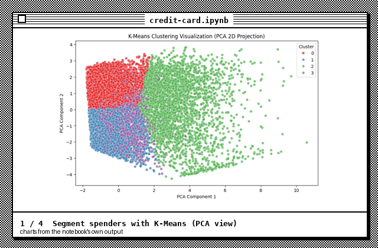

<code>Pune, IN</code> ·
<code>B.Tech Robotics, class of 2027</code> ·
<code>published, IJCIS 2025</code>

 

Final-year robotics engineer, **moving up the stack** from machines to the AI and software that run them. I build sensing-and-decision systems: robots that map and navigate, vision models that find people in the dark, and AI agents that investigate and fix incidents.

**Tools I've built with:** ROS 2 · Nav2 · SLAM · sensor fusion · Python · C · C++ · PyTorch · OpenCV · YOLO11 · RAG · Random Forest · XGBoost · SQL · React · Arduino · Jetson

 

<table>
  <tr><td align="center" width="50%" valign="top"><a href="https://github.com/aryankhanna1409/sentinel"><b>Sentinel</b></a> RGB + thermal fusion with YOLO11 to find people in the dark </td><td align="center" width="50%" valign="top"><a href="https://github.com/aryankhanna1409/nexus"><b>nexus</b></a> Network-intelligence and DevSecOps platform; an AI agent (Claude or NVIDIA NIM) finds the root cause and fixes it </td></tr>
  <tr><td align="center" width="50%" valign="top"><a href="https://github.com/aryankhanna1409/finintel"><b>finintel</b></a> RAG system for grounded, citation-backed financial reports </td><td align="center" width="50%" valign="top"><a href="https://github.com/aryankhanna1409/dishdecoded"><b>DishDecoded</b></a> Snap a dish or menu, get its story and recipe </td></tr>
  <tr><td align="center" width="50%" valign="top"><a href="https://github.com/aryankhanna1409/credit-card"><b>credit-card</b></a> Spending-habit segmentation and reward prediction (published, IJCIS 2025) </td><td align="center" width="50%" valign="top"><a href="https://github.com/aryankhanna1409/autonomous-bot"><b>autonomous-bot</b></a> ROS 2 robot: SLAM, Nav2, IoT dashboard and a swarm auction. No demo recording yet </td></tr>
</table>

 

